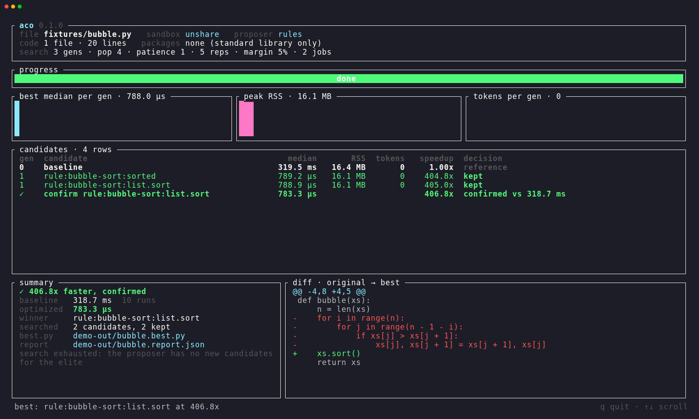
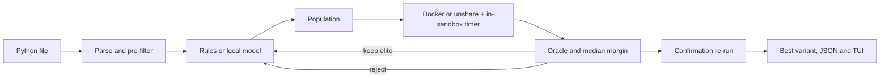

# aco: Autonomous Code Optimizer

`aco` is a Rust CLI that looks for faster versions of a Python file by running them. It proposes rewrites, runs each one in a sandbox, and keeps a rewrite only when its output matches the original and its measured median time is at least 5% lower. Before it reports a winner, it re-runs the winner and the original in an interleaved batch, and the winner has to clear the 5% bar again.

This is evolutionary search with a measured reward, not a trained policy.

Repository: https://github.com/ayaan-cs/aco



A 62-second real terminal recording (bubble.py in the dashboard, a multi-file project with `--mutate`, numpy with its requirements in `--plain`, then slower.py rejected) is at [release-run/demo.mp4](release-run/demo.mp4); its script is [release-run/demo.tape](release-run/demo.tape).

## Install

aco is one binary (static on Linux). It runs Python only inside a sandbox, so it also needs **Docker** or, on Linux, **unprivileged user namespaces**, plus **python3**.

| | Prebuilt binary | Sandbox aco uses | Also needs |
|---|---|---|---|
| Linux x86_64 / aarch64 | yes (static, musl) | Docker if the daemon answers, else `unshare` (util-linux) with unprivileged user namespaces | `python3` under `/usr` for the unshare sandbox |
| macOS arm64 / x86_64 | yes | Docker only: Docker Desktop, OrbStack or colima, running | nothing else (packages are installed inside the Docker image; a host `python3` only improves the message for syntax aco cannot parse) |
| Windows | no | not supported natively. Under WSL2, install the Linux build inside the distribution and use Docker Desktop's WSL integration (or unshare, if the WSL kernel allows unprivileged user namespaces). WSL2 is not tested in CI. | |

Without a working sandbox aco exits with status 3 and says what is missing; it never runs code unsandboxed.

**Install script** (Linux and macOS; POSIX sh, no sudo):

```sh
curl -fsSL https://raw.githubusercontent.com/ayaan-cs/aco/main/scripts/install.sh | sh
# a pinned version and another directory:
curl -fsSL https://raw.githubusercontent.com/ayaan-cs/aco/main/scripts/install.sh | sh -s -- --version v0.1.0 --dir ~/bin
```

It detects the OS and CPU, downloads the matching archive from the [latest release](https://github.com/ayaan-cs/aco/releases/latest) (or `--version`), checks it against the release's `SHA256SUMS`, refuses to install on a mismatch, and puts `aco` in `~/.local/bin` (or `--dir` / `$ACO_INSTALL_DIR`). It tells you if that directory is not on your `PATH`. `--quiet` prints only the installed path; colour follows the terminal and `NO_COLOR`. Uninstall with `rm ~/.local/bin/aco` (cache: `~/.cache/aco`).


<sub>A real recording ([install.tape](release-run/install.tape), [mp4](release-run/install.mp4), [still](release-run/still-install.png)): the published v0.1.0 release installed on a Debian 13 x86_64 machine without Docker, into `/tmp/aco-demo-install`.</sub>

**Manual download.** Each [release](https://github.com/ayaan-cs/aco/releases) has `aco-<version>-<target>.tar.gz` for `x86_64-unknown-linux-musl`, `aarch64-unknown-linux-musl`, `x86_64-apple-darwin` and `aarch64-apple-darwin`, and a `SHA256SUMS` file:

```sh
v=v0.1.0 t=aarch64-apple-darwin
curl -fLO https://github.com/ayaan-cs/aco/releases/download/$v/aco-$v-$t.tar.gz
curl -fLO https://github.com/ayaan-cs/aco/releases/download/$v/SHA256SUMS
grep " aco-$v-$t.tar.gz$" SHA256SUMS | shasum -a 256 -c -     # Linux: sha256sum -c -
tar -xzf aco-$v-$t.tar.gz && mv aco-$v-$t/aco ~/.local/bin/
```

The macOS binaries are not signed or notarized. A file downloaded with a browser gets the quarantine attribute and Gatekeeper blocks it; remove it with `xattr -d com.apple.quarantine ~/.local/bin/aco` (curl downloads, including the install script, are not quarantined).

**With Cargo** (Rust 1.88 or newer):

```sh
cargo install --locked --git https://github.com/ayaan-cs/aco --tag v0.1.0
# or from a checkout
git clone https://github.com/ayaan-cs/aco && cd aco && cargo build --release --locked   # binary: target/release/aco
```

`--locked` uses the tested dependency versions; without it Cargo picks the newest compatible ones, which may need a newer Rust.

**First run:**

```sh
aco --help
git clone https://github.com/ayaan-cs/aco && cd aco
aco fixtures/bubble.py            # live dashboard; `aco --plain ...` for line output
```

## How a run works



1. **Parse and pre-filter.** `rustpython-parser` parses the script and every local module it imports. Code that calls `exec`, `eval`, `open`, `getattr` and similar builtins, touches dunder attributes (other than data-model methods such as `__init__` and `super().__init__()`), or imports `os`, `subprocess`, `socket` and other system modules is rejected before any process starts, with `file:line`. `sys` is allowed for `argv`, `stdin`/`stdout`/`stderr`, `exit`, recursion and int-digit limits, and read-only facts such as `maxsize`. This list is a quick first check that saves a sandbox run. It is **not** the security boundary; the sandbox is (see [SECURITY.md](SECURITY.md)).
2. **Propose.** The default proposer is a set of deterministic AST rules: bubble sort becomes `sorted()`/`list.sort()`, string `+=` in a loop becomes list appends plus `"".join`, and membership tests against a list become a set built once. `--proposer ollama` asks a local OpenAI-compatible model for a full replacement file.
3. **Measure.** A small harness inside the sandbox runs the candidate once as a warmup, then times `--reps` runs (default 5) with `perf_counter_ns`. Container or namespace startup is never timed. The score is the median.
4. **Gate.** A candidate is kept only if its stdout, stderr and exit code match the baseline's (or its stdout and exit code match a `--check` file) and its median is at least `--margin` (5%) under the current best. Search runs use `PYTHONHASHSEED=0`. The best candidate becomes the elite, and the next generation is proposed from it.
5. **Stop.** Stops at `--gens` (default 3), or earlier after `--patience` (default 1) generations without a new elite. With the deterministic rules it also stops as soon as they have nothing new to offer for the current elite ("search exhausted"). `--pop` (default 4) is the population size, including the elite.
6. **Confirm.** The elite and the baseline are re-measured alternately (B, C, B, C, ...) for `2 × reps` rounds in fresh sandboxes. Round *i* runs both with `PYTHONHASHSEED=i`, and they must behave identically under every seed, which rejects rewrites whose output depends on set iteration order (they can pass at seed 0 by luck). The elite must clear the margin on the medians and be faster in at least 75% of the paired rounds. Otherwise the baseline is reported as best and the report says why.

Scripts whose baseline runs in under 1 ms are reported as "too fast to measure reliably" and left alone: at that scale run-to-run noise rivals the 5% margin.

Reward, used only to rank candidates that already passed the gate:

```
reward = speedup - 0.15 * memory_ratio - 0.05 * token_ratio
```

`speedup` is baseline median over candidate median, `memory_ratio` is candidate peak RSS over baseline peak RSS, and `token_ratio` is model tokens over `--token-budget` (512). Rules cost 0 tokens. Time is the gate; memory and tokens only break ties between passing candidates, and keep a model from winning with a huge rewrite.

## Usage

```sh
aco --plain fixtures/bubble.py fixtures/concat.py fixtures/lookup.py fixtures/slower.py
```

`aco --help` lists every option by group (Search, Proposer, Sandbox, Output) with examples and exit codes.

- **Dashboard.** Without `--plain`, `aco` shows a live Ratatui dashboard: a header (file, sandbox, proposer, settings), a progress gauge (generation and candidate, then confirmation round), sparklines for best median, peak RSS and tokens per generation, a candidate table with kept/rejected status, and at the end a summary panel and a diff of the winner against the original. `↑`/`↓` scroll the table. `q` or Ctrl-C cancels a run (sandboxes are killed at once) and exits when it is done; pressing it again while cancelling forces the exit. Below 80×24 it shows a "terminal too small" notice until you resize. The terminal is restored on exit, cancel, SIGINT/SIGTERM and panic, and the summary is printed to the scrollback afterwards.
- **Plain.** `--plain`, or any run whose stdout is not a terminal, prints aligned lines and the same end-of-run summary (with the diff). Colour follows `--color auto|always|never`; `auto` turns it off for pipes, `TERM=dumb` and a non-empty [`NO_COLOR`](https://no-color.org).
- **Exit status.** 0 done, 1 a file failed in the sandbox (for example the original itself crashes or times out), 2 bad input or usage (missing, empty, non-UTF-8 or unparsable file, policy violation), 3 no sandbox available, 130 cancelled.
- `--json` writes `<name>.report.json` next to `<name>.best.py` in `--out` (default `aco-out/`).
- `--check expected.txt` compares candidates against a fixed expected stdout instead of the baseline's output.
- `--sandbox auto|docker|unshare` (default `auto`: Docker if the daemon answers, else unshare on Linux, else exit with a message naming both).

A real run of the four fixtures and 15 stress cases is in [release-run/](release-run/): the plain transcript, the JSON reports, and [the bench table](release-run/bench.md) (`python3 scripts/bench.py` regenerates it). [release-run/VERIFY.md](release-run/VERIFY.md) is the end-to-end verification matrix (every fixture in the dashboard, `--plain` and `--json`, output equivalence, rejection, policy, sandbox limits, bad inputs, the model proposer, cancellation, resize, colour, and three repeats of each speedup), produced by [scripts/verify.py](scripts/verify.py).

## Projects, packages and inputs

**Local imports.** `aco app/main.py` follows the script's imports the way Python resolves them (the script's directory first, then `--project-root`, which defaults to that directory) and copies the import closure into the sandbox read-only at `/proj`. Packages, `from . import x` and other relative imports inside packages, and namespace packages work. `.git`, virtualenvs (any directory with `pyvenv.cfg`), `node_modules`, `site-packages`, caches and build output are never copied, and a closure over 1,000 files or 20 MB is refused. Every local file passes the pre-filter. One file is rewritten per run: the script, or the module named by `--mutate`. When the rules find nothing in the script but do in an imported module, `aco` says which one to pass to `--mutate`:

```sh
aco --mutate app/shop/inventory.py app/main.py   # run main.py, rewrite inventory.py
```

**Third-party packages.** Requirements come from `--requirements FILE`, else a `requirements.txt` or `pyproject.toml` (`[project].dependencies`) in the project root; `--no-requirements` turns discovery off. Only plain PyPI requirements are accepted (names, version specifiers, extras, environment markers; no URLs, paths or pip options). They are installed once, as wheels only (`pip --only-binary=:all:`), before and outside any timed run, and cached by interpreter and requirements: under unshare into `~/.cache/aco` (or `$ACO_CACHE_DIR`) with the host `python3`; under Docker into a derived image `aco-deps:<hash>` built from the pinned base. A package with no wheel for the interpreter, an unreachable index, and an import that is neither standard library, local nor installed (`imports yaml … Add PyYAML to a requirements.txt`) are reported by name before anything runs. Imports inside `try:` are treated as optional. Installed packages are not policy-checked; the sandbox contains them (see [SECURITY.md](SECURITY.md)).

**Inputs.** `--stdin FILE` feeds a file to the script's stdin, and arguments after `--` become `sys.argv[1:]`: `aco --stdin input.txt solve.py -- 3`. Both are the same for every run, so the comparison is on that input. Output must be repeatable: a script that prints unseeded random numbers, times or object ids is rejected with "nondeterministic output" before the search starts.

**Source files.** UTF-8 with or without a BOM, LF or CRLF, tabs or spaces. `.best.py` keeps the original's BOM and line endings. Non-UTF-8 files (and `coding:` declarations other than UTF-8) are refused with an `iconv` command to convert them. The parser covers Python syntax through 3.12 except PEP 701 f-strings that reuse the outer quote inside a replacement field; those files are refused with the line number.

## Sandboxes

**Docker (preferred, and the only option on macOS).** The image is `python:3.12-slim`, pinned by digest in [sandbox/image.txt](sandbox/image.txt) and pulled on first use. Each candidate runs with `--network none --read-only --cap-drop ALL --security-opt no-new-privileges`, pid, memory and CPU limits, the `nobody` user, a tmpfs `/tmp`, and only the harness, the candidate and the project snapshot mounted read-only. No host environment is passed; the sandbox sets only `PYTHONHASHSEED` and single-thread settings for BLAS/OpenMP.

On macOS, the per-run directories that are mounted into the container live under `~/.cache/aco/run` (colima and Lima share only your home directory with the VM; set `ACO_SCRATCH_DIR` to move them). CI covers Docker on macOS end to end on Intel only (`macos-15-intel` with colima); on Apple silicon it builds and runs the tests without a sandbox, and Docker Desktop and OrbStack are not tested.

**unshare (Linux fallback).** It uses `unshare --user --map-root-user --mount --pid --fork --mount-proc --net`, builds a private root that contains only a read-only `/usr`, the harness and candidate, the project snapshot and installed packages (all read-only), `pivot_root`s into it and detaches the host filesystem, drops every capability with `setpriv --no-new-privs`, clears the environment, and applies CPU, memory, file-size, process and open-file limits with `prlimit`. It needs util-linux (`unshare`, `setpriv`, `prlimit`, `pivot_root`) and `python3` under `/usr`.

It also needs **unprivileged user namespaces**. If they are disabled, `aco` refuses to run and names the settings to check: `kernel.unprivileged_userns_clone` (Debian-style kernels) and `kernel.apparmor_restrict_unprivileged_userns` (Ubuntu 23.10 and later, including 24.04, turn this on). Whether to change them is your decision. `aco` never changes them, and installing Docker is the alternative.

## Local model

```sh
ollama pull qwen2.5-coder:1.5b        # default; qwen2.5-coder:3b is the larger local option
aco --proposer ollama fixtures/lookup.py
aco --proposer both --model qwen2.5-coder:3b fixtures/lookup.py
```

Any server with `POST /v1/chat/completions` works, including llama.cpp's `llama-server` (`--endpoint http://127.0.0.1:8080`). `python3 scripts/verify.py model` runs the search against such a server; [release-run/VERIFY.md](release-run/VERIFY.md) has a real run with Qwen2.5-Coder-1.5B (Q4_K_M) on llama.cpp, CPU only. The default endpoint is `http://127.0.0.1:11434`. Replies are capped at `--token-budget` tokens and must contain a complete replacement file. Replies that fail to parse or fail the pre-filter are dropped before they reach the sandbox. Token counts come from the server's `usage` field, or are estimated from bytes when it is missing. Nothing in CI or the tests downloads model weights; the tests use a local mock server. When a confirmed winner includes a model rewrite, the summary adds a **review** line: in that real run the 1.5B model replaced lookup.py's loop with a program that computes the same count for that input by other means. It passed, correctly, because its output is identical, which is exactly the limit described below.

## What it will not do

- It does not guarantee optimal code. It keeps rewrites that were measured faster on your input.
- It is not a trained or learned policy. The search is evolutionary, scored by measurement.
- It does not prove equivalence. "Same stdout, stderr and exit code on this run's input, under several hash seeds" is the oracle, so a rewrite that changes behaviour your program never prints, or that is only right for this input, could pass. The built-in rules are written to be equivalent in general (each refuses to fire when, for example, the list is aliased, mutated through `global` or read by a nested function, or a loop variable is used after the loop); model rewrites are not, so read their diff. Use `--check`, `--stdin` and representative inputs.
- It rewrites one file per run, and only local code: installed packages are used as they are.
- It does not run a check command on the host (no `--check-cmd`): anything that runs your code runs in the sandbox.
- It is not a multi-tenant sandbox service, and it should not be pointed at files from the internet. See [SECURITY.md](SECURITY.md).
- It never runs a candidate without a sandbox, and never weakens one to make a run work.

## Tests

```sh
cargo test
cargo clippy --all-targets -- -D warnings
cargo fmt --check
```

The isolation tests check that a host environment variable is absent, a host file is unreadable, network connects fail, a spin loop is killed by the timeout, a 1 GiB allocation fails under a 256 MiB limit, and a cancel kills a running sandbox. Docker cases skip with a message when no daemon is reachable, and unshare cases skip with the probe's reason when user namespaces are unavailable. CI (Ubuntu 24.04) runs the Docker cases and an end-to-end Docker run; the unshare cases skip there because of the AppArmor user-namespace restriction. `tests/cli.rs` covers exit codes, diagnostics, colour and the JSON report through the binary, and `tests/tui.rs` renders the dashboard into a test backend at several sizes. `tests/stress.rs` runs the generated cases in [fixtures/stress](fixtures/stress) ([scripts/gen_stress.py](scripts/gen_stress.py)): 300-3000-line files, a package-based project, numpy plus a pure-Python package, semantics traps, stdin/argv/exit codes, nondeterministic output, encodings and newer syntax. `tests/hangup.rs` closes the terminal under a finished dashboard and requires a prompt exit.

End-to-end verification against the release build (needs `pip install pyte`):

```sh
cargo build --release && python3 scripts/verify.py            # core and stress sections
ACO_VERIFY_ENDPOINT=http://127.0.0.1:8088 python3 scripts/verify.py model   # a real local model
```

## License

MIT, see [LICENSE](LICENSE).
