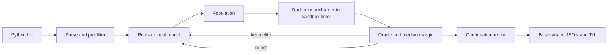

# aco: Autonomous Code Optimizer

`aco` is a Rust CLI that looks for faster versions of a Python file by running them. It proposes rewrites, runs each one in a sandbox, and keeps a rewrite only when its output matches the original and its measured median time is at least 5% lower. Before it reports a winner, it re-runs the winner and the original in an interleaved batch, and the winner has to clear the 5% bar again.

This is evolutionary search with a measured reward, not a trained policy.

Repository: https://github.com/ayaan-cs/aco

## How a run works



1. **Parse and pre-filter.** `rustpython-parser` parses the file. Files that call `exec`, `eval`, `open`, `getattr` and similar builtins, touch dunder attributes, or import `os`, `sys`, `subprocess`, `socket` and other system modules are rejected before any process starts. This list is a quick first check that saves a sandbox run. It is **not** the security boundary; the sandbox is (see [SECURITY.md](SECURITY.md)).
2. **Propose.** The default proposer is a set of deterministic AST rules: bubble sort becomes `sorted()`/`list.sort()`, string `+=` in a loop becomes list appends plus `"".join`, and membership tests against a list become a set built once. `--proposer ollama` asks a local OpenAI-compatible model for a full replacement file.
3. **Measure.** A small harness inside the sandbox runs the candidate once as a warmup, then times `--reps` runs (default 5) with `perf_counter_ns`. Container or namespace startup is never timed. The score is the median.
4. **Gate.** A candidate is kept only if its stdout matches the baseline (or a `--check` file) and its median is at least `--margin` (5%) under the current best. The best candidate becomes the elite, and the next generation is proposed from it.
5. **Stop.** Stops at `--gens` (default 3), or earlier after `--patience` (default 1) generations without a new elite. `--pop` (default 4) is the population size, including the elite.
6. **Confirm.** The elite and the baseline are re-measured alternately (B, C, B, C, ...) for `2 × reps` rounds in fresh sandboxes. If the elite no longer clears the margin, the baseline is reported as best and the report says why.

Reward, used only to rank candidates that already passed the gate:

```
reward = speedup - 0.15 * memory_ratio - 0.05 * token_ratio
```

`speedup` is baseline median over candidate median, `memory_ratio` is candidate peak RSS over baseline peak RSS, and `token_ratio` is model tokens over `--token-budget` (512). Rules cost 0 tokens. Time is the gate; memory and tokens only break ties between passing candidates, and keep a model from winning with a huge rewrite.

## Build and run

```sh
cargo build --release
./target/release/aco --plain fixtures/bubble.py fixtures/concat.py fixtures/lookup.py fixtures/slower.py
```

- Without `--plain`, `aco` shows a live Ratatui dashboard with sparklines for best median time, peak RSS and tokens per generation, plus a candidate table. Press `q` to cancel, or to exit when the run is done. When stdout is not a terminal it prints plain lines.
- `--json` writes `<name>.report.json` next to `<name>.best.py` in `--out` (default `aco-out/`).
- `--check expected.txt` compares candidates against a fixed expected stdout instead of the baseline's output.
- `--sandbox auto|docker|unshare` (default `auto`: Docker if the daemon answers, else unshare on Linux, else exit with a message naming both).

A real run of the four fixtures is in [release-run/](release-run/): the plain transcript, one JSON report per fixture, and [the bench table](release-run/bench.md).

## Sandboxes

**Docker (preferred, and the only option on macOS).** The image is `python:3.12-slim`, pinned by digest in [sandbox/image.txt](sandbox/image.txt) and pulled on first use. Each candidate runs with `--network none --read-only --cap-drop ALL --security-opt no-new-privileges`, pid, memory and CPU limits, the `nobody` user, a tmpfs `/tmp`, and only the harness and candidate mounted read-only. No host environment is passed.

**unshare (Linux fallback).** It uses `unshare --user --map-root-user --mount --pid --fork --mount-proc --net`, builds a private root that contains only a read-only `/usr` and the two files, `pivot_root`s into it and detaches the host filesystem, drops every capability with `setpriv --no-new-privs`, clears the environment, and applies CPU, memory, file-size, process and open-file limits with `prlimit`. It needs util-linux (`unshare`, `setpriv`, `prlimit`, `pivot_root`) and `python3` under `/usr`.

It also needs **unprivileged user namespaces**. If they are disabled, `aco` refuses to run and names the settings to check: `kernel.unprivileged_userns_clone` (Debian-style kernels) and `kernel.apparmor_restrict_unprivileged_userns` (Ubuntu 23.10 and later, including 24.04, turn this on). Whether to change them is your decision. `aco` never changes them, and installing Docker is the alternative.

## Local model

```sh
ollama pull qwen2.5-coder:1.5b        # default; qwen2.5-coder:3b is the larger local option
aco --proposer ollama fixtures/lookup.py
aco --proposer both --model qwen2.5-coder:3b fixtures/lookup.py
```

Any server with `POST /v1/chat/completions` works, including llama.cpp's `llama-server` (`--endpoint http://127.0.0.1:8080`). The default endpoint is `http://127.0.0.1:11434`. Replies are capped at `--token-budget` tokens and must contain a complete replacement file. Replies that fail to parse or fail the pre-filter are dropped before they reach the sandbox. Token counts come from the server's `usage` field, or are estimated from bytes when it is missing. Nothing in CI or the tests downloads model weights; the tests use a local mock server.

## What it will not do

- It does not guarantee optimal code. It keeps rewrites that were measured faster on your input.
- It is not a trained or learned policy. The search is evolutionary, scored by measurement.
- It does not prove equivalence. "Same stdout on this run" is the oracle, so a rewrite that changes behaviour your program never prints could pass. Use `--check` and representative inputs.
- It is not a multi-tenant sandbox service, and it should not be pointed at files from the internet. See [SECURITY.md](SECURITY.md).
- It never runs a candidate without a sandbox, and never weakens one to make a run work.

## Tests

```sh
cargo test
cargo clippy --all-targets -- -D warnings
```

The isolation tests check that a host environment variable is absent, a host file is unreadable, network connects fail, and a spin loop is killed by the timeout. Docker cases skip with a message when no daemon is reachable, and unshare cases skip with the probe's reason when user namespaces are unavailable.

## License

MIT, see [LICENSE](LICENSE).
